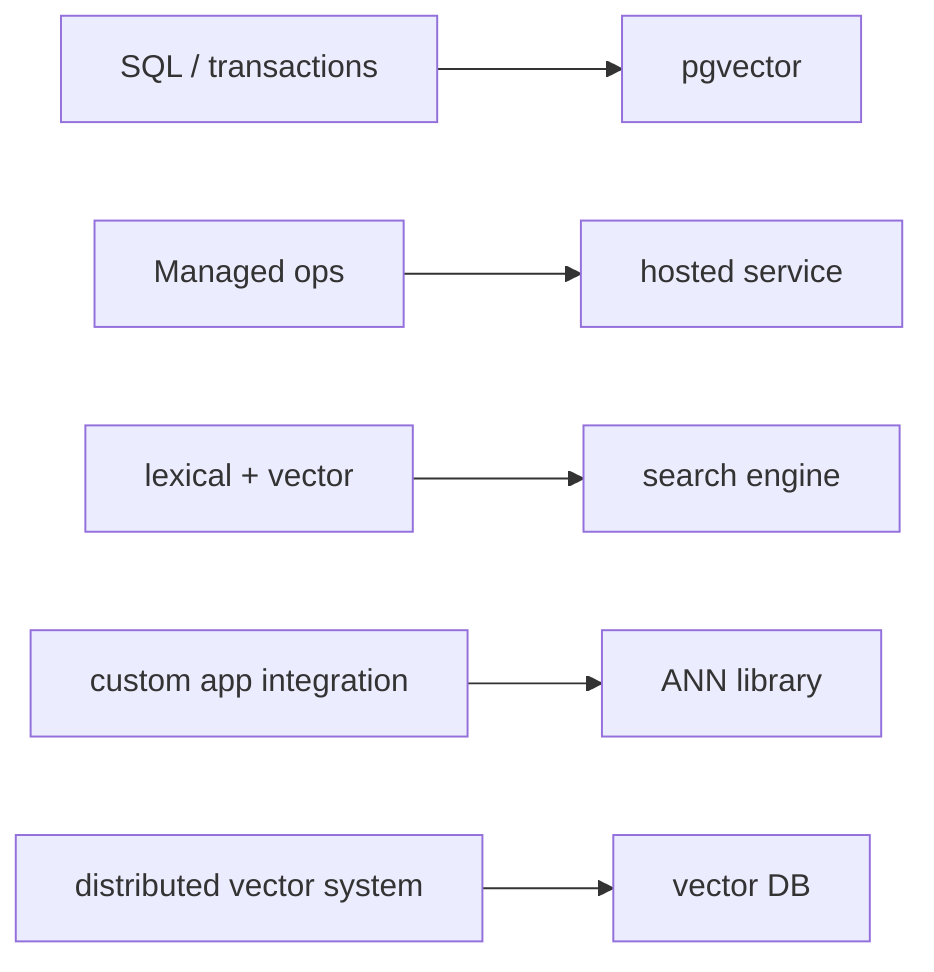

# Database comparison matrix

> **TL;DR:** Choose the category by operational constraints first, then qualify candidates with a shared workload benchmark.

**Figure 1: Simplified conceptual view of this topic.**

**Takeaway:** Follow the arrows to see where the method spends work and where the main trade-off enters.

### How to read this

- Follow arrows in the direction data or decisions move.
- The labels name the main components; they do not promise a specific implementation.
- Use the table and field notes below to connect the picture to measurements.

**Visual takeaway:** The diagram shows the main data or decision path; labels are conceptual, not performance guarantees.

## Field notes

| Category | Strength | Responsibility to validate |
|---|---|---|
| PostgreSQL + extension | SQL, joins, transactions | filtered ANN plans, index maintenance |
| ANN library | algorithm control | persistence, filtering, recovery |
| Search engine | lexical + vector hybrid | shard cost, vector-version behavior |
| Vector database | purpose-built APIs / distribution | consistency, updates, tenancy, operations |
| Managed service | reduced infrastructure ownership | residency, contract, cost, export/restore |

## Sources

[pgvector](https://github.com/pgvector/pgvector) · [PostgreSQL indexes](https://www.postgresql.org/docs/current/indexes.html). Product behavior and defaults can vary by release; pin the version used in any benchmark.

**Next:** [Master index](../00-INDEX.md) · [Glossary](../99-glossary.md).
