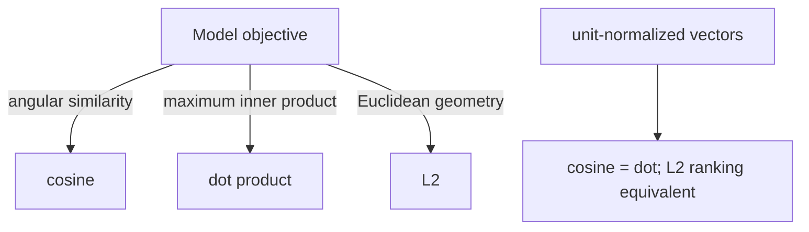

# Distance metric chooser

> **TL;DR:** Match the index metric to the embedding model’s training and serving semantics; normalization changes the relationship between scores.

**Figure 1: Simplified conceptual view of this topic.**

**Takeaway:** Follow the arrows to see where the method spends work and where the main trade-off enters.

### How to read this

- Follow arrows in the direction data or decisions move.
- The labels name the main components; they do not promise a specific implementation.
- Use the table and field notes below to connect the picture to measurements.

**Visual takeaway:** The diagram shows the main data or decision path; labels are conceptual, not performance guarantees.

## Field notes

| Metric | Typical use | Check |
|---|---|---|
| Cosine | Directional similarity | Zero-vector handling; normalization |
| Dot product | MIPS / trained inner product | Norms affect ranking |
| Squared L2 | Euclidean distance | Same ranking as L2; units are squared |

## Sources

[ANN survey](https://arxiv.org/abs/1806.09823) · [FAISS paper](https://arxiv.org/abs/1702.08734). Product behavior and defaults can vary by release; pin the version used in any benchmark.

**Next:** [Master index](../00-INDEX.md) · [Glossary](../99-glossary.md).
