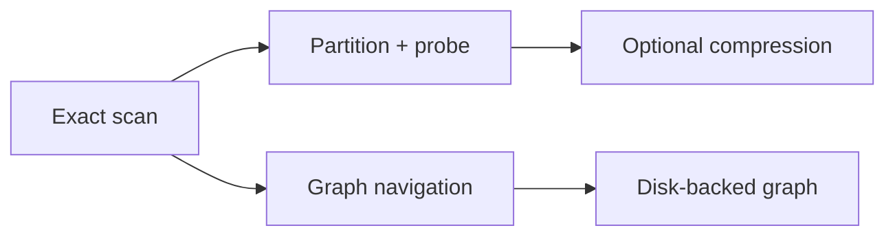

# Index algorithm comparison

> **TL;DR:** Flat is the quality baseline; IVF limits which lists are scanned; graph methods navigate neighbors; disk ANN trades RAM residency for SSD access.

**Figure 1: Simplified conceptual view of this topic.**

**Takeaway:** Follow the arrows to see where the method spends work and where the main trade-off enters.

### How to read this

- Follow arrows in the direction data or decisions move.
- The labels name the main components; they do not promise a specific implementation.
- Use the table and field notes below to connect the picture to measurements.

**Visual takeaway:** The diagram shows the main data or decision path; labels are conceptual, not performance guarantees.

## Field notes

| Flat | Exact result; work grows with corpus size | GPU/batched baseline, smaller corpora |
| IVF-Flat | Probe selected coarse lists | Controllable scan fraction |
| HNSW | Traverse multi-layer graph | High-recall in-memory CPU search |
| PQ | Compress vectors into codes | Memory-constrained search; validate recall |
| DiskANN | SSD-resident graph search | Large corpus when RAM is constrained |

## Sources

[ANN survey](https://arxiv.org/abs/1806.09823) · [FAISS paper](https://arxiv.org/abs/1702.08734). Product behavior and defaults can vary by release; pin the version used in any benchmark.

**Next:** [Master index](../00-INDEX.md) · [Glossary](../99-glossary.md).
