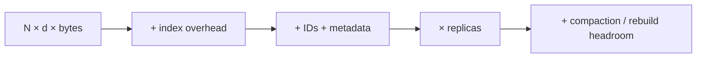

# Memory sizing

> **TL;DR:** Raw vectors are the floor; index structures, metadata, replicas, and peak rebuild space determine deployment capacity.

**Figure 1: Simplified conceptual view of this topic.**

**Takeaway:** Follow the arrows to see where the method spends work and where the main trade-off enters.

### How to read this

- Follow arrows in the direction data or decisions move.
- The labels name the main components; they do not promise a specific implementation.
- Use the table and field notes below to connect the picture to measurements.

**Visual takeaway:** The diagram shows the main data or decision path; labels are conceptual, not performance guarantees.

## Field notes

| Representation | Vector bytes per row (before index/metadata) |
|---|---:|
| float32 | 4d |
| float16 | 2d |
| int8 | about d |
| PQ with m bytes | m |

Example: 100M × 768 × 4 = 307.2 GB decimal (about 286 GiB) for float32 vectors alone.

## Sources

[ANN survey](https://arxiv.org/abs/1806.09823) · [FAISS paper](https://arxiv.org/abs/1702.08734). Product behavior and defaults can vary by release; pin the version used in any benchmark.

**Next:** [Master index](../00-INDEX.md) · [Glossary](../99-glossary.md).
