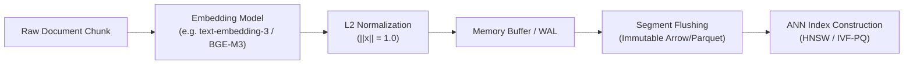
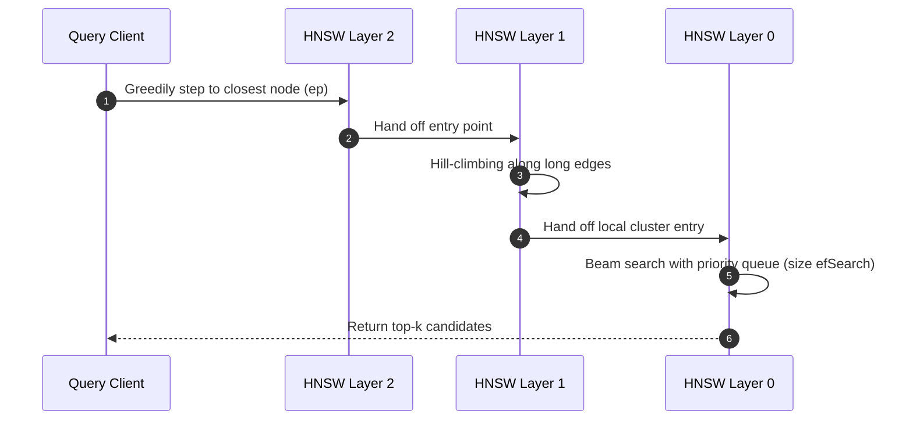
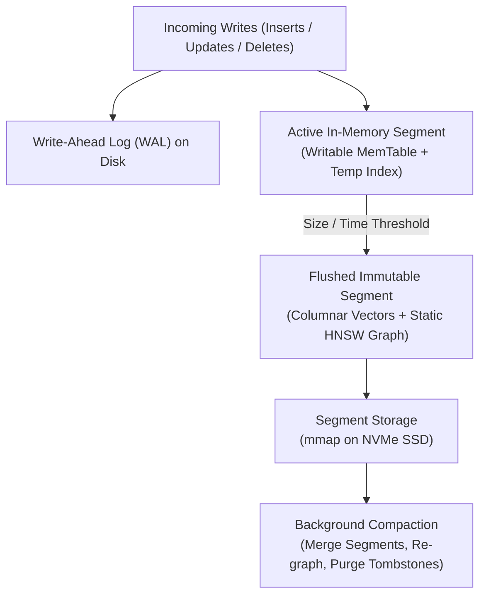
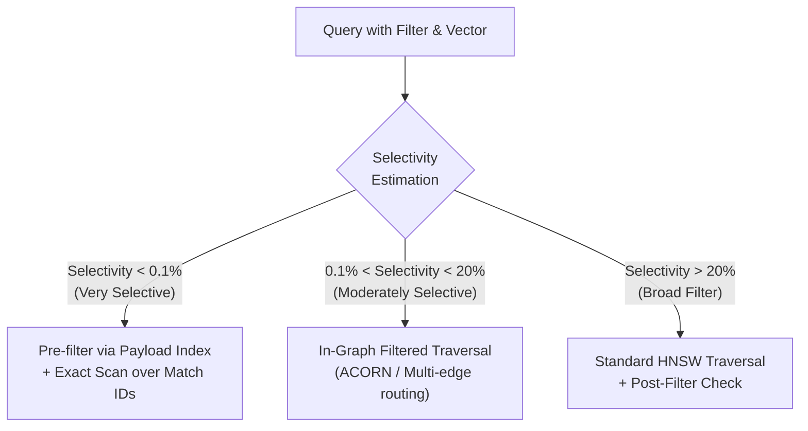
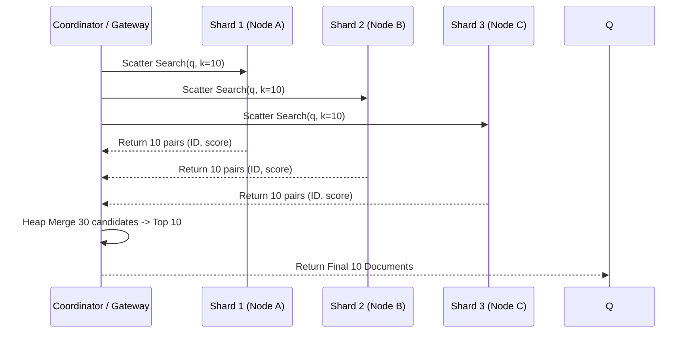

# Vector Database Internals: From Embedding Geometry to Production Systems

> **Audience:** Senior / Staff AI & Systems Engineers who understand standard software engineering and want first-principles depth on approximate nearest neighbor (ANN) search, high-dimensional geometry, memory tiering, and distributed retrieval pipelines.
>
> **TL;DR:** A vector database is not merely a FAISS wrapper or an in-memory index; it is a full stateful storage engine balancing non-metric distance calculations, cache-line-friendly graph traversals, segment LSM flushes, filtered recall cliffs, and distributed top-$k$ reduction under sub-50ms p99 SLA budgets.

---

## 1. What Is a Vector Database, Really?

**A vector database is an ACID-adjacent, mutable storage engine engineered around non-partitionable geometric distance searches rather than relational B-Trees or inverted term postings.**

Traditional relational databases (PostgreSQL, MySQL) index scalar data using $B^+$-Trees where values possess a strict total order ($a < b < c$). Searching takes $O(\log N)$ by binary partitioning along 1D boundaries. Text search engines (Lucene, Elasticsearch) index discrete lexical tokens via inverted lists: term $\to$ sorted posting list of document IDs, merged via galloping intersections.

Vector retrieval breaks both paradigms:
1. **No Total Order:** High-dimensional vectors $\mathbf{x} \in \mathbb{R}^d$ ($d \in [256, 3072]$) have no natural linear ordering. You cannot build a 1D $B^+$-Tree over points in 1536-dimensional space.
2. **Dense Geometry:** Unlike sparse bag-of-words where two documents match if they share exact tokens, dense embeddings occupy continuous latent manifolds. Every vector has a non-zero coordinate along almost every dimension.
3. **Continuous Top-$k$ Objective:** We solve for:
   $$\text{top-}k(\mathbf{q}, \mathcal{D}) = \arg\max_{\mathbf{x} \in \mathcal{D}}^{(k)} \text{sim}(\mathbf{q}, \mathbf{x})$$

```
┌────────────────────────────────────────────────────────────────────────┐
│                        Traditional DB vs Vector DB                     │
├────────────────────────────────┬───────────────────────────────────────┤
│ Feature                        │ Vector Database                       │
├────────────────────────────────┼───────────────────────────────────────┤
│ Index Structure                │ Proximity Graphs (HNSW), Voronoi (IVF)│
│ Search Paradigm                │ Beam search / Greedy hill-climbing    │
│ Update Mutability              │ Immutable LSM segments + tombstones   │
│ Filtering Cost                 │ Severe recall penalty at high select. │
│ Memory Footprint               │ High (vectors + edge lists in RAM)   │
└────────────────────────────────┴───────────────────────────────────────┘
```

### The Metric Space Contract

The geometry is dictated by the embedding model's loss formulation:
- **Cosine Distance:** Measures angle $\theta \in [0, \pi]$:
  $$\cos(\mathbf{q}, \mathbf{x}) = \frac{\mathbf{q} \cdot \mathbf{x}}{\|\mathbf{q}\|_2 \|\mathbf{x}\|_2}$$
- **Inner Product (MIPS):** Maximizes $\sum_{i=1}^d q_i x_i$. Sensitive to vector magnitudes.
- **Euclidean ($L_2$ Squared):**
  $$\|\mathbf{q} - \mathbf{x}\|_2^2 = \|\mathbf{q}\|_2^2 + \|\mathbf{x}\|_2^2 - 2(\mathbf{q} \cdot \mathbf{x})$$

> [!NOTE]
> When all vectors are normalized to unit sphere ($\|\mathbf{x}\|_2 = 1.0$), **Euclidean distance, Inner Product, and Cosine similarity are strictly monotonic transformations of one another**:
> $$\|\mathbf{q} - \mathbf{x}\|_2^2 = 2 - 2\cos(\mathbf{q}, \mathbf{x})$$
> Normalizing vectors at ingestion enables replacing expensive square roots and divisions with pure SIMD dot-products (`_mm512_dpbusd_epi32` or AVX-512 FMA).



---

## 2. The Nearest Neighbor Problem & Dimensionality

Exact $k$-Nearest Neighbors ($k$NN) calculates the distance between query $\mathbf{q}$ and every vector $\mathbf{x}_i \in \mathcal{D}$:
$$\text{Cost} = \Theta(N \cdot d)$$

For $N = 10^7$ vectors at $d = 1536$ in `float32`, a single query requires:
$$10^7 \times 1536 \times 4\text{ bytes} \approx 61.44\text{ GB scan}$$
Even at 100 GB/s memory bandwidth, scanning takes $\approx 614\text{ ms}$, capping single-thread throughput at 1.6 QPS. This is unacceptable for production latency budgets ($<20\text{ ms}$).

### The Curse of Dimensionality: Distance Concentration

As dimension $d \to \infty$, the contrast between the distance to the nearest neighbor and the furthest neighbor vanishes ([Beyer et al., 1999](https://link.springer.com/chapter/10.1007/3-540-49257-7_15)):
$$\lim_{d \to \infty} \frac{\text{dist}_{\max} - \text{dist}_{\min}}{\text{dist}_{\min}} \to 0$$

Partitioning trees (like $k$-d trees or $R^*$-trees) degrade to full $O(N)$ linear scans when $d > 20$, because hyperplanes split data poorly, forcing the search to backtrack across almost all tree branches.

### The ANN Pareto Frontier

Approximate Nearest Neighbor (ANN) trades guaranteed exact recall for orders-of-magnitude lower latency:

$$\text{Recall}@k = \frac{|\mathcal{R}_{\text{ANN}} \cap \mathcal{R}_{\text{exact}}|}{k}$$

```
Latency (ms)
  ▲
  │        ┌─────────────────────────┐
50│        │ Flat Exact Scan (100%)  │
  │        └─────────────────────────┘
  │
15│                   ┌────────────────────────┐
  │                   │ HNSW (Recall 98-99%)   │
 5│        ┌──────────┴─────────────┐          │
  │        │ IVF-PQ (Recall 90-95%) │          │
 1│        └────────────────────────┴──────────┘
  └──────────────────────────────────────────────► Recall@k
   0.80               0.90         0.98       1.0
```

---

## 3. Indexing Algorithms — Under The Hood

### 1. Hierarchical Navigable Small World (HNSW)

HNSW ([Malkov & Yashunin, 2018](https://arxiv.org/abs/1603.09320)) adapts probabilistic skip-lists into multi-layer proximity graphs.

```
Layer 2 (Express):    [A] ──────────────────────────► [K]
                       │                               │
Layer 1 (Regional):   [A] ──────────► [E] ──────────► [K]
                       │               │               │
Layer 0 (Local):      [A] ──► [B] ──► [E] ──► [G] ──► [K] ──► [Z]
```

#### Build Mechanism
1. Each inserted node is assigned an exponential decay maximum layer $l = \lfloor -\ln(\text{uniform}(0, 1)) \cdot m_L \rfloor$, where $m_L = 1/\ln(M)$.
2. **Greedy Descent:** From global `enter_point` down to layer $l+1$, perform greedy 1-hop search to find the closest local node.
3. **Layer Insertion:** At layers $\min(l, l_{\max})$ down to 0, run heuristic neighbor discovery with beam width `efConstruction`.
4. **Diverse Edge Heuristic:** Rather than picking the absolute closest $M$ points, HNSW prunes edges that form sharp triangles (shrink factor heuristic). This maintains navigability across clusters and prevents isolated graph islands.

#### Search Mechanism
At query time, the search traverses greedily from top layers down to layer 0. At layer 0, a priority queue of size `efSearch` explores candidates. `efSearch` directly controls the Pareto curve between latency and recall.



### 2. Inverted File Index with Product Quantization (IVF-PQ)

Used for multi-hundred-million scale when RAM budgets prevent storing full raw vectors in HNSW graphs.

```
Vector Space                    Inverted Lists (Voronoi Cells)
┌───────────────────────┐       Centroid 0: [Doc3, Doc89, Doc1042, ...]
│    • c0        • c1   │       Centroid 1: [Doc12, Doc44, Doc891, ...]
│                       │       Centroid 2: [Doc7, Doc55, Doc201, ...]
│          • c2         │       ...
└───────────────────────┘
```

1. **Centroid Training:** $k$-means clusters the dataset into `nlist` Voronoi cells (typically $4\sqrt{N}$ to $16\sqrt{N}$).
2. **Inverted Posting Lists:** Each vector is assigned to its nearest centroid. The residual $\mathbf{r} = \mathbf{x} - \mathbf{c}$ is computed and compressed via Product Quantization (PQ).
3. **Query Probing:** At search time, query $\mathbf{q}$ is compared against all `nlist` centroids. The closest `nprobe` lists are opened, and their quantized residuals are scored via precomputed lookup tables (Asymmetric Distance Computation).

### 3. DiskANN & Vamana: Overcoming the RAM Wall

When indexing 1B+ vectors, RAM costs dominate ($10^9 \times 1536 \times 4\text{ bytes} \approx 6.14\text{ TB}$ RAM). DiskANN ([Subramanya et al., 2019](https://dl.acm.org/doi/10.5555/3454287.3454477)) maintains a single-layer **Vamana graph** residing on NVMe SSD, keeping only compressed vectors (or compressed centroids) in RAM.

- **Vamana Graph Alpha Pruning:** Connects neighbors with an explicit tolerance factor $\alpha \ge 1.0$, creating long-range shortcuts that keep graph diameter tiny while capping node degree $R$.
- **Beam Search on NVMe:** Traversal performs batched, asynchronous direct I/O (`io_uring` or `libaio`) reads to SSD blocks. One query typically needs only 16 to 32 SSD page reads ($4\text{KB}$ each), completing in 2 to 4 ms.

---

## 4. Vector Compression: Squeezing Dimensions into Cache

```
Compression Hierarchy:
┌─────────────────┬───────────────┬─────────────────┬──────────────────────┐
│ Method          │ Bytes/Dim     │ Typical Ratio   │ Primary Advantage    │
├─────────────────┼───────────────┼─────────────────┼──────────────────────┤
│ FP32 (Raw)      │ 4 bytes       │ 1x (Baseline)   │ Perfect fidelity     │
│ FP16 / BF16     │ 2 bytes       │ 2x              │ Minimal recall loss  │
│ INT8 (SQ8)      │ 1 byte        │ 4x              │ AVX2/NEON integer SIMD│
│ PQ (e.g. M=64)  │ ~0.125 bytes  │ 16x - 32x       │ Fits billions in RAM │
│ 1-Bit (RaBitQ)  │ 1 bit         │ 32x             │ POPCNT instruction   │
└─────────────────┴───────────────┴─────────────────┴──────────────────────┘
```

### Scalar Quantization (SQ8)
Maps continuous floating points linearly into 8-bit unsigned integers $[0, 255]$:
$$x_{\text{quant}} = \left\lfloor \frac{x - x_{\min}}{x_{\max} - x_{\min}} \times 255 \right\rceil$$
Enables using integer SIMD dot products (`VPMADDUBSW` on x86), reducing memory bandwidth by 75% with $<0.5\%$ recall degradation on modern dense models.

### Product Quantization (PQ) & Asymmetric Distance Computation (ADC)
A $d$-dimensional vector is decomposed into $m$ orthogonal sub-vectors of size $d/m$. Each subspace is clustered into $k^* = 256$ centroids (1 byte code per subspace).

```
Vector (d=1024):  [  Sub-vector 1  |  Sub-vector 2  | ... |  Sub-vector 64  ]
                        │                  │                      │
Quantized Code:       [Byte 0]           [Byte 1]    ...       [Byte 63]  --> 64 bytes total!
```

**Asymmetric Distance Computation (ADC):** The query $\mathbf{q}$ is NOT quantized. For each sub-vector of $\mathbf{q}$, we compute distance to all 256 centroids and store them in an $m \times 256$ lookup table in L1 cache. Scoring any stored document is a sequence of $m$ table lookups and additions:
$$\text{dist}(\mathbf{q}, \mathbf{x}) \approx \sum_{j=1}^m \text{LUT}_j[\text{code}_j(\mathbf{x})]$$

### Matryoshka Representation Learning (MRL)
Trained embeddings ([Kusupati et al., 2022](https://arxiv.org/abs/2205.13147)) where early sub-vectors (e.g. first 64 or 128 dimensions) capture the primary semantic variance. 
- **Two-Phase Cascade:** Search the first 64 dims using fast in-memory HNSW to retrieve top 500 candidates, then rerank those 500 using the full 1536 dims fetched from SSD.

---

## 5. Storage Engine Internals: LSM Trees, Segments, and WAL

Vector DBs must survive crashes, allow dynamic updates, and support concurrent read-write transactions. They cannot freeze the world while rebuilding an HNSW graph.



### Immutable Segments & Tombstoning
1. **LSM Architecture:** Writes are appended sequentially to a Write-Ahead Log (WAL) and written to an active in-memory segment (similar to Lucene or RocksDB).
2. **Freezing:** When the segment reaches capacity (e.g. 1M vectors), it is frozen, converted to an immutable file containing columnar vectors, payload attributes, and a dedicated static HNSW index.
3. **Deletions & Updates:** In HNSW, deleting a node breaks graph connectivity. Real engines do not re-wire edges on every delete. Instead, they write to a **Roaring Bitmap tombstone mask**. Deleted vectors are skipped during graph traversal.
4. **Compaction:** When tombstone ratios exceed thresholds (e.g., 20-30%), background compaction merges small segments into larger ones, rebuilding pristine HNSW graphs without deleted nodes.

---

## 6. Query Processing & The Filtered Search Problem

Real-world production queries almost always combine geometric similarity with metadata filters:
```sql
SELECT * FROM vectors 
WHERE tenant_id = 'org_44' AND created_year >= 2024
ORDER BY embedding <=> query_vector 
LIMIT 10;
```

```
Selectivity = (Matching Documents) / (Total Documents)
```

```
┌────────────────────────────────────────────────────────────────────────┐
│                     The Filtered Recall Breakdown                      │
├─────────────────┬──────────────────────────────────────────────────────┤
│ Strategy        │ Behavior & Failure Mode                              │
├─────────────────┼──────────────────────────────────────────────────────┤
│ Post-Filtering  │ Search ANN graph -> filter results.                  │
│                 │ Fails when selectivity < 1%: 100 ANN candidates      │
│                 │ yield 0 matches. Returns empty/sparse results.       │
├─────────────────┼──────────────────────────────────────────────────────┤
│ Pre-Filtering   │ Query metadata index -> scan matching vectors.       │
│                 │ Degrades to full brute-force scan if 50% match.     │
├─────────────────┼──────────────────────────────────────────────────────┤
│ In-Graph Filter │ Traverse HNSW graph, but only visit/evaluate         │
│ (ACORN/Qdrant)  │ nodes passing payload bitmask. Can still get trapped │
│                 │ in dead-end disconnected components if filter sparse.│
└─────────────────┴──────────────────────────────────────────────────────┘
```



---

## 7. Distributed Architecture: Sharding & Top-$k$ Reduction

At scale ($10^8$ to $10^{10}$ vectors), single nodes run out of memory and IOPS.



### Partitioning Strategies
- **Hash-based Sharding (Common):** Shard ID = `hash(doc_id) % num_shards`. Every shard holds a random sample of the vector space. Requires scatter-gather across all shards for every search.
- **Tenant-based Sharding:** All data for a tenant lives on a dedicated shard or collection. Eliminates scatter-gather for multi-tenant SaaS applications.
- **Centroid-based (Clustered) Sharding:** Assign documents to shards based on global $k$-means centroids. The coordinator queries only the 2-3 most relevant shards. Hard to rebalance when data drifts.

---

## 8. System Comparison: Internals & Trade-offs

```
┌───────────────┬──────────────┬──────────────────┬────────────────────────┬──────────────────────┐
│ System        │ Language     │ Core Index       │ Storage Model          │ Ideal Sweet Spot     │
├───────────────┼──────────────┼──────────────────┼────────────────────────┼──────────────────────┤
│ Qdrant        │ Rust         │ HNSW + Payload   │ Custom mmap Segments   │ Production RAG,      │
│               │              │ Inverted Index   │ RocksDB/Pagecache      │ Heavy filtering      │
├───────────────┼──────────────┼──────────────────┼────────────────────────┼──────────────────────┤
│ Milvus        │ Go / C++     │ Knowhere (HNSW,  │ S3 / MinIO + Kafka     │ 100M+ cloud scale,   │
│               │              │ IVF, DiskANN)    │ log broker             │ multi-cluster ops    │
├───────────────┼──────────────┼──────────────────┼────────────────────────┼──────────────────────┤
│ pgvector      │ C (Postgres) │ HNSW / IVFFlat   │ Postgres 8KB pages /   │ Existing PG stack,   │
│               │              │                  │ shared_buffers         │ <10M vectors         │
├───────────────┼──────────────┼──────────────────┼────────────────────────┼──────────────────────┤
│ LanceDB       │ Rust         │ IVF-PQ / DiskANN │ Lance Columnar file    │ Serverless, local,   │
│               │              │                  │ (direct NVMe/S3 reads) │ multi-modal data     │
└───────────────┴──────────────┴──────────────────┴────────────────────────┴──────────────────────┘
```

---

## 9. Capacity Planning & Production Sizing

### Sizing Formula for HNSW
For $N$ vectors of dimension $d$ with link parameter $M$:

$$\text{RAM}_{\text{total}} = N \cdot \left[ (d \times 4\text{ bytes}) + (M \times 2 \times 8\text{ bytes}) + \text{Metadata}(64\text{ bytes}) \right] \times 1.25$$

**Example: 10 Million Vectors ($d=1536$, $M=16$):**
- Vectors (FP32): $10^7 \times 1536 \times 4\text{ B} = 61.44\text{ GB}$
- Graph Edges: $10^7 \times 16 \times 2 \times 8\text{ B} = 2.56\text{ GB}$ (layer 0 bidirectional links + upper layers)
- Metadata & Internal Bitmaps: $\approx 1.2\text{ GB}$
- 25% Buffer for Compaction & Queries:
  $$\text{RAM} \approx (61.44 + 2.56 + 1.2) \times 1.25 \approx 81.5\text{ GB}$$

---

## 10. Production Failure Modes & Runbook

1. **Compaction OOM Spikes:** During segment merge, both the old segments and the newly constructed HNSW graph co-exist in memory. Keep 30% RAM headroom.
2. **Selective Filter Recall Collapse:** If your application adds a filter (e.g. `user_id = '...'`) that matches $<0.1\%$ of records, HNSW graph search will drop to 0% recall or loop endlessly. Enforce pre-filtering with B-Tree indexes when selectivity drops below 1%.
3. **Silent Metric Mismatch:** Ingesting unnormalized vectors into a Cosine index that implements inner product under the hood will silently degrade retrieval quality without throwing errors. Enforce schema assertions on vector magnitude at ingest.
4. **Tombstone Poisoning:** Heavy updates without compaction accumulate deleted tombstoned nodes in HNSW layers, degrading traversal connectivity and dropping recall over time. Track `tombstone_ratio` in Prometheus and trigger scheduled compactions.

---

## References

1. Malkov, Y. A., & Yashunin, D. A. (2018). *Efficient and robust approximate nearest neighbor search using Hierarchical Navigable Small World graphs*. IEEE TPAMI. [arXiv:1603.09320](https://arxiv.org/abs/1603.09320)
2. Jégou, H., Douze, M., & Schmid, C. (2011). *Product Quantization for Nearest Neighbor Search*. IEEE TPAMI. [HAL:inria-00514462](https://inria.hal.science/inria-00514462)
3. Subramanya, S. J., Devvrit, F., Simhadri, H. V., Krishnawamy, R., & Kadekodi, R. (2019). *DiskANN: Fast Accurate Bilateral Approximate Nearest Neighbor Search on Large-Scale Data*. NeurIPS 2019. [Microsoft Research](https://www.microsoft.com/en-us/research/publication/diskann-fast-accurate-bilateral-approximate-nearest-neighbor-search-on-large-scale-data/)
4. Kusupati, A., et al. (2022). *Matryoshka Representation Learning*. NeurIPS 2022. [arXiv:2205.13147](https://arxiv.org/abs/2205.13147)
5. Beyer, K., et al. (1999). *When Is "Nearest Neighbor" Meaningful?* ICDT.
